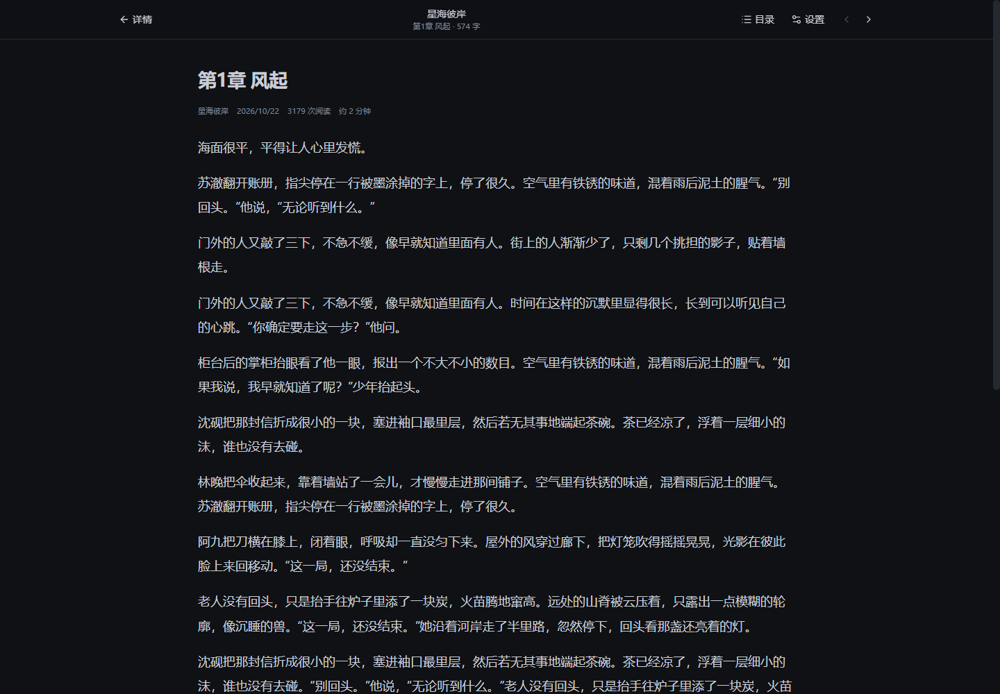
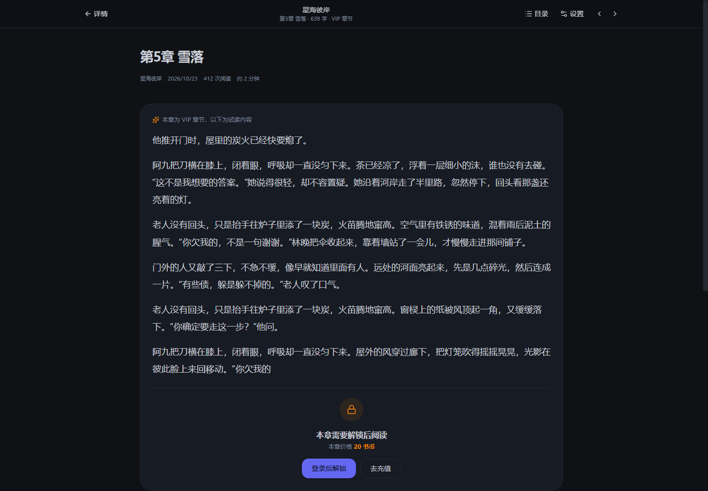
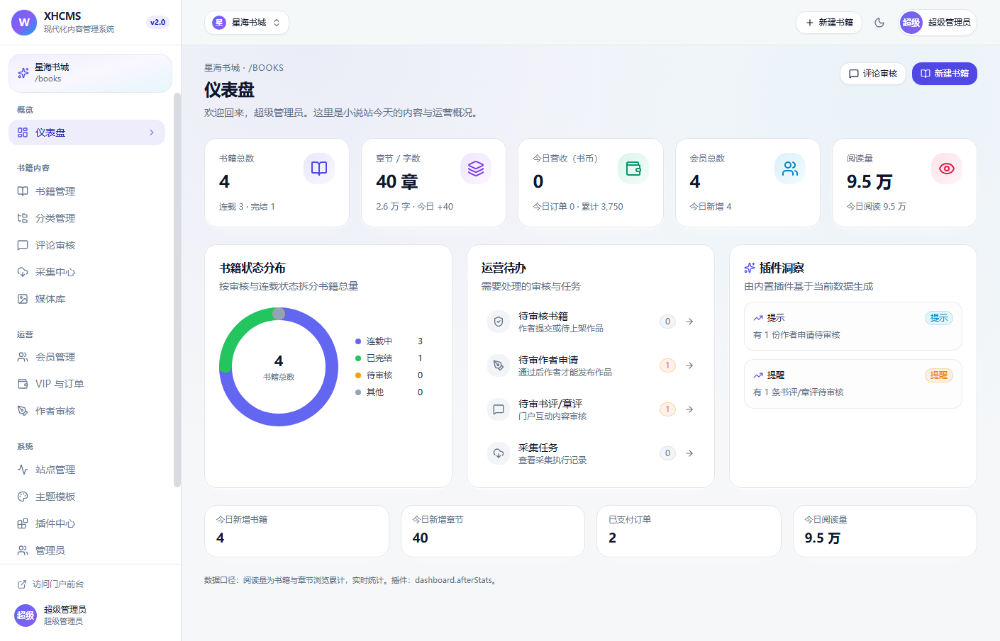
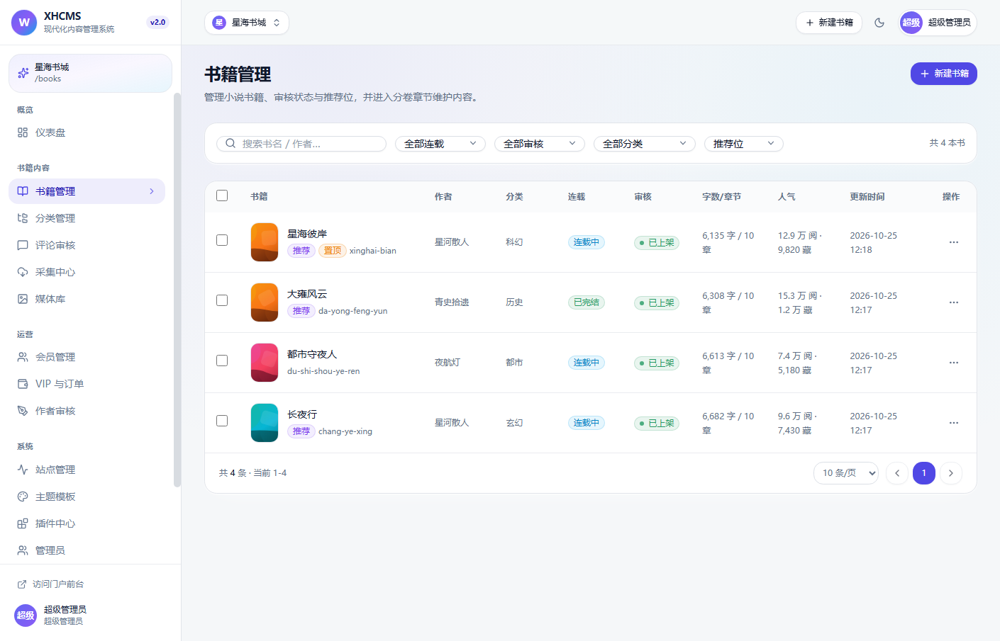
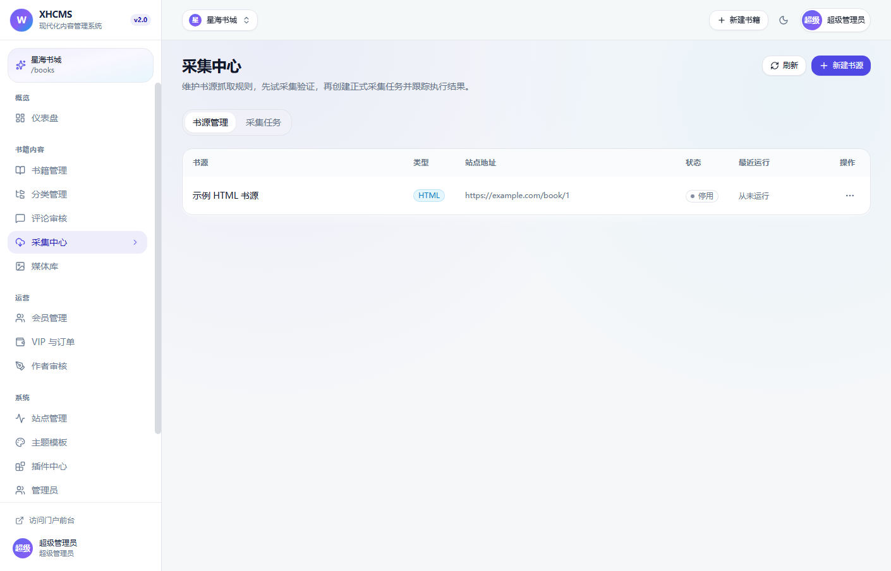
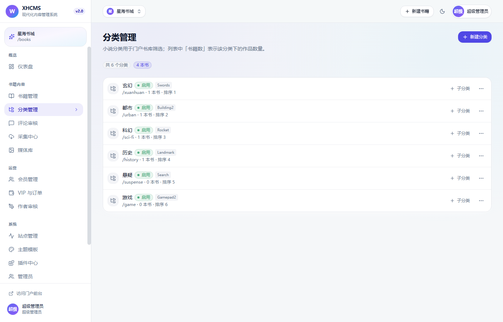
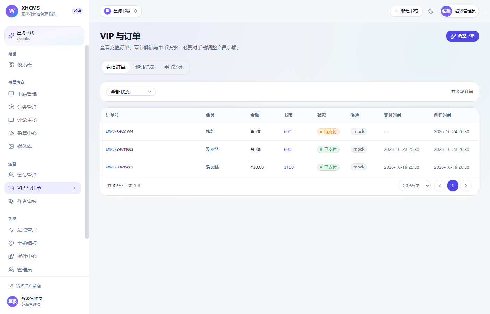
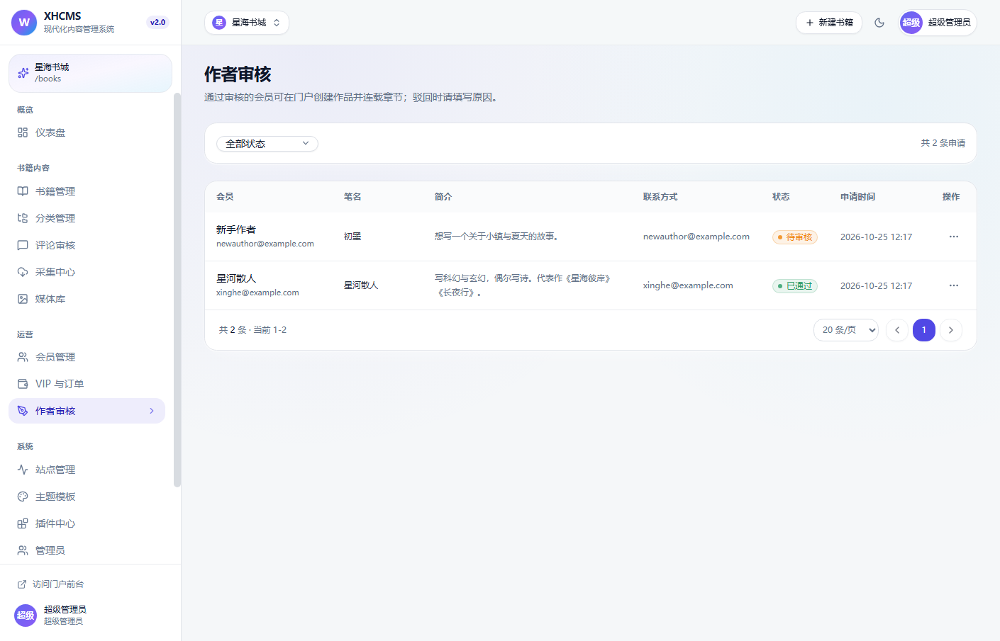

# XHCMS Novel 2.0

[](https://github.com/544735/xhcms-novel/actions/workflows/ci.yml)
[](https://github.com/544735/xhcms-novel/actions/workflows/release.yml)
[](https://github.com/544735/xhcms-novel/actions/workflows/docker.yml)
[](LICENSE)

> 现代化小说网站 —— **NestJS 11 + Next.js 15 + TypeScript + Prisma** 全栈实现。
> 保留经典 XHCMS 的多站点 / 会员 / 评论 / 主题 / 插件 / RBAC 底座，把内容域重构为 **书籍 · 分卷 · 章节 · 阅读器 · VIP 付费 · 作者中心 · 采集**。

## 📦 发布版本与使用手册

| 内容 | 位置 |
| --- | --- |
| **发布包（ZIP，可直接分发/部署）** | [`release/xhcms-novel-2.0.0.zip`](release/xhcms-novel-2.0.0.zip)（约 7.7 MB，含源码、文档、截图、部署脚本） |
| **使用手册（Markdown，图文）** | [`docs/使用手册.md`](docs/使用手册.md) |
| **使用手册（Word，内嵌截图）** | [`docs/XHCMS小说站使用手册.docx`](docs/XHCMS小说站使用手册.docx) |
| 发布说明 / 变更 | [`RELEASE_NOTES.md`](RELEASE_NOTES.md) |
| 部署脚本 | 一键部署 [`deploy/deploy-windows.ps1`](deploy/deploy-windows.ps1) / [`deploy/deploy-linux.sh`](deploy/deploy-linux.sh)；Docker [`deploy/docker-up.ps1`](deploy/docker-up.ps1) / [`deploy/docker-up.sh`](deploy/docker-up.sh)；停止/重启 [`deploy/stop-windows.ps1`](deploy/stop-windows.ps1)、[`deploy/start-windows.ps1`](deploy/start-windows.ps1)；Nginx 示例 [`deploy/nginx.conf.example`](deploy/nginx.conf.example) |
| GitHub / CI / Docker | [`docs/DEPLOY_GITHUB.md`](docs/DEPLOY_GITHUB.md) · `.github/workflows/{ci,release,docker}.yml` · [`scripts/github-publish.ps1`](scripts/github-publish.ps1) |

重新打包：`powershell -ExecutionPolicy Bypass -File scripts/package-release.ps1`（版本号读取 `VERSION`）。

---

## ✨ 功能

| 模块 | 能力 |
| --- | --- |
| **多站点** | 一套后台管理多个书站，`siteId` 作用域隔离 + 站点级授权（`X-Site-Id`），两套入口（域名解析 / `/{site}` 前缀） |
| **书库** | 书籍 CRUD、分类树、连载/完结、推荐/置顶、审核上下架、批量操作、封面选择器 |
| **分卷章节** | 分卷目录、章节纯文本编辑（实时字数）、VIP 章节定价、发布/撤回、`chapterNo` 自增、字数与章节数自动重算 |
| **TXT 导入** | 上传 TXT 自动识别 UTF-8/GBK，按「第×章」正则分章，一键导入成书 |
| **阅读器** | 沉浸式无干扰阅读：字号/行高/宽度/5 种背景、目录抽屉、上下章、←→ 翻页、每 20% 自动保存进度、章评 |
| **VIP 付费** | 书币钱包、4 档充值套餐、模拟支付、章节解锁（事务扣费 + 流水 + 幂等）、未解锁试读（插件按比例生成） |
| **会员** | 注册/登录（独立 JWT）、会员中心、书架、阅读历史、我的书评、消费记录 |
| **作者中心** | 读者申请作者 → 后台审核 → 作品管理 → 章节编辑（草稿/发布/VIP 定价）→ 数据概览 |
| **采集中心** | 书源 CRUD（HTML CSS 选择器 / JSON 路径）、试采集预览、正式采集（新建或追加书籍、章节去重、限速）、任务记录 |
| **书评章评** | 树形评论、前置审核、敏感词/链接拦截插件、后台批量审核 |
| **排行榜/搜索** | 热门/新书/收藏/字数四榜，书名作者搜索，作者主页 |
| **RBAC** | 65 个权限点、4 个内置角色、30s 缓存、改权即时生效、全量操作审计 |
| **插件机制** | DB 启停 + 热生效、钩子广播、异常隔离；5 个内置插件（章节统计 / VIP 试读 / 书籍 SEO / 评论卫士 / Sitemap 增强） |
| **主题** | 3 套小说主题（modern 星海夜读 / magazine 墨香书卷 / minimal 极简纯读），站点级切换 + 品牌色注入 |
| **SEO** | 书籍/章节/分类/作者 metadata、canonical、OG、sitemap.xml、rss.xml、robots.txt |
| **后台** | 小说仪表盘（书籍/章节/营收/会员/阅读/待办/插件洞察）、书籍章节管理、采集、VIP、作者审核、评论、分类、媒体、站点、主题、插件、用户角色、日志、设置；暗色模式、响应式、骨架屏、Toast |

## 🧱 技术栈

- **后端**：NestJS 11、Prisma 6、PostgreSQL 16（pg_trgm 中文子串检索、部分唯一索引）、JWT（管理员/会员双密钥）、class-validator、sanitize-html、cheerio + iconv-lite（采集）、Swagger
- **前端**：Next.js 15 App Router（RSC/SSR）、React 19、TypeScript 5.9（strict）、TanStack Query 5、Zustand 5、Tailwind CSS 3、lucide-react
- **工程**：pnpm workspaces、共享契约包 `@wmcms/shared`、Jest 29 + Supertest 7 e2e

## 📁 目录结构

```
wmcms/
├─ apps/
│  ├─ api/                      # NestJS API（/api/v1）
│  │  ├─ prisma/                # schema + 小说站种子数据
│  │  └─ src/
│  │     ├─ common/             # Prisma、守卫、过滤器、插件宿主、工具
│  │     └─ modules/
│  │        ├─ novels/          # 书籍/分卷/章节 + 门户书库/阅读器/排行/搜索 + TXT 导入
│  │        ├─ reader/          # 书架/进度/书评章评/作者中心/公开作者页
│  │        ├─ vip/             # 钱包/订单/解锁/管理端 + 小说仪表盘
│  │        ├─ collect/         # 书源/采集引擎/任务 + 演示书源
│  │        ├─ auth|users|roles|audit|sites|categories|media|settings|themes|plugins|members|comments|forms|dashboard
│  │        └─ articles|tags    # 旧 CMS 内容模块（仅管理端保留，导航已隐藏）
│  └─ web/                      # Next.js（门户 + 管理后台）
│     └─ src/
│        ├─ app/(portal)/       # 双入口门户：首页/书库/分类/详情/阅读器/排行/搜索/作者/会员/书架/VIP/作者中心
│        ├─ app/admin/          # 管理后台（小说域）
│        ├─ components/         # ui / admin / portal（server 主题视图 + client 交互）
│        ├─ themes/             # modern / magazine / minimal 三套小说主题
│        └─ lib/                # api 客户端、服务端取数、站点解析、token
├─ packages/shared/             # 共享类型 + 权限 + 主题/套餐常量 + 插件清单
├─ docs/                        # NOVEL_API / ARCHITECTURE / DEVELOPMENT / API_CONTRACT（旧 CMS）
└─ scripts/                     # 一键安装（install.sh/install.ps1，含环境检测）、封面生成、移动端溢出检查、后台 CDP 验收
```

## 🚀 快速开始

### 一键部署（推荐）

部署脚本会**先自动拉取仓库最新代码**（检测到未提交改动时自动跳过，避免覆盖本地修改；可用 `-NoPull` / `--no-pull` 关闭），
然后完成环境检测、依赖安装、数据库初始化、构建、启动与健康检查。

```powershell
# Windows：自动生成环境变量与随机密钥、装依赖、初始化数据库、构建、启动并做健康检查
powershell -ExecutionPolicy Bypass -File deploy\deploy-windows.ps1 -Seed
```

```bash
# Linux / macOS（--systemd 可生成 systemd 服务并开机自启；默认自动 git pull，--no-pull 可跳过）
bash deploy/deploy-linux.sh --seed
```

参数：`-Seed`（演示数据）、`-SkipInstall`、`-NoBuild`、`-NoStart`、`-FreshEnv`、`-NoPull`（跳过自动拉取）、`-PublicUrl`、`-ApiPort/-WebPort`；Linux 对应 `--seed` / `--skip-install` / `--no-build` / `--no-start` / `--no-pull` / `--public-url` / `--api-port` / `--web-port`。停止/重启见 [`deploy/stop-windows.ps1`](deploy/stop-windows.ps1) / [`deploy/start-windows.ps1`](deploy/start-windows.ps1)，详见 [使用手册 §7](docs/使用手册.md#7-部署与运维)。

### 一键拉取并安装（Docker，自动环境检测）

无需先克隆仓库：脚本会**自动检测环境 → 拉取/更新代码 → 生成随机密钥 → 构建并启动 → 健康检查**，
并在不满足条件时给出明确的修复提示。

```bash
# Linux / macOS
curl -fsSL https://raw.githubusercontent.com/544735/xhcms-novel/main/scripts/install.sh | bash
```

```powershell
# Windows（PowerShell 5.1+）
powershell -ExecutionPolicy Bypass -c "irm https://raw.githubusercontent.com/544735/xhcms-novel/main/scripts/install.ps1 | iex"
```

仅检测环境、不做任何修改（环境不满足时以非零码退出）：

```bash
curl -fsSL https://raw.githubusercontent.com/544735/xhcms-novel/main/scripts/install.sh | bash -s -- --check
```
```powershell
powershell -ExecutionPolicy Bypass -c "& ([scriptblock]::Create((irm https://raw.githubusercontent.com/544735/xhcms-novel/main/scripts/install.ps1))) -Check"
```

自动检测项：操作系统/架构、Git、Node.js（≥ 20）、Docker 版本与**守护进程状态**、Docker Compose v2、
目标端口 3000/4000 占用、目标目录是否已有仓库（有则改为增量更新）；安装后轮询健康检查，失败自动输出容器日志。

- 安装目录默认 `./xhcms-novel`，可用 `XHCMS_DIR` 覆盖；仓库/分支可用 `XHCMS_REPO_URL` / `XHCMS_BRANCH` 覆盖。
- 首次安装自动生成 `POSTGRES_PASSWORD` 与三个 JWT 密钥；初始管理员口令写入数据卷
  `/data/.seed-credentials.txt`，首次登录后请改密并删除。
- 后台还提供可视化入口：登录后访问 **`/admin/about`**（系统 → 关于与安装），可直接复制上述命令。

> 说明：本节脚本使用 Docker Compose + PostgreSQL；上方 `deploy/*.ps1` / `deploy/*.sh` 是传统的原生 Node 部署方式。

### 手动部署

```bash
# 环境：Node ≥ 20、pnpm 11、Docker（本地 PostgreSQL）
pnpm install
cp apps/api/.env.example apps/api/.env
cp apps/web/.env.example apps/web/.env.local

# 启动本地 PostgreSQL(:5433) + Redis(:6379)
pnpm infra:up

# 初始化数据库（PostgreSQL：应用迁移 + 种子数据，7 本书 / 70 章 / 双站点 / 会员 / VIP 订单 / 书评 / 采集书源）
pnpm db:deploy
pnpm --filter @wmcms/api db:seed

# 开发模式（API :4000 · Web :3000）
pnpm dev
# 或分别启动
pnpm dev:api
pnpm dev:web
```

- 门户：<http://localhost:3000>（默认 `books` 星海书城）· <http://localhost:3000/ink>（墨香书屋）
- 后台：<http://localhost:3000/admin>
- API 文档：<http://localhost:4000/api/docs>

### 演示账号（种子数据）

| 角色 | 账号 | 密码 | 说明 |
| --- | --- | --- | --- |
| 超级管理员 | `admin` | 见 `.seed-credentials.txt`（生产随机）/ `SEED_ADMIN_PASSWORD`；开发默认 `Admin@123456` | 全部权限、双站点 |
| 内容编辑 | `editor` | 见 `.seed-credentials.txt`（生产随机）/ `SEED_EDITOR_PASSWORD`；开发默认 `Editor@123456` | 书籍/章节/审核/采集/分类/媒体 |
| 运营专员 | `operator` | 见 `.seed-credentials.txt`（生产随机）/ `SEED_OPERATOR_PASSWORD`；开发默认 `Operator@123456` | VIP 订单、作者审核、会员 |
| 读者 | `alice` | 见 `.seed-credentials.txt`（生产随机）/ `SEED_MEMBER_PASSWORD`；开发默认 `Member@123456` | 书币 860、已解锁章节、书架/进度 |
| 读者 | `bob` / `carol` | 同上（`SEED_MEMBER_PASSWORD`）；开发默认 `Member@123456` | 普通读者（carol 在 ink 站） |
| 作者 | `xinghe` | 同上（`SEED_MEMBER_PASSWORD`）；开发默认 `Member@123456` | 笔名「星河散人」，《星海彼岸》《长夜行》 |
| 作者 | `moxiang` | 同上（`SEED_MEMBER_PASSWORD`）；开发默认 `Member@123456` | 笔名「墨香公子」，《春深不知处》《你是我的星河》 |

> 生产环境（`NODE_ENV=production`）首次 seed 若未提供 `SEED_*_PASSWORD`，会随机生成口令并写入 `apps/api/.seed-credentials.txt`（容器内可用 `SEED_CREDENTIALS_FILE` 指到 `/data` 卷），日志不会打印口令；首个登录后请立即改密并删除该文件。表中「开发默认」口令仅限本地开发/演示，生产为随机生成。仓库不包含生产密钥。

## 🗺️ 主要路由

| 门户 | 说明 |
| --- | --- |
| `/`、`/ink` | 站点首页（hero、推荐、热门榜、分类、最新/完结） |
| `/books?category=&status=&sortBy=` | 书库（分类/状态/排序/关键词/分页） |
| `/category/[slug]` | 分类页 |
| `/book/[slug]` | 书籍详情（分卷目录、首章/最新章节、书架、书评） |
| `/read/[novelSlug]/[chapterNo]` | 阅读器（VIP 锁定态试读 + 解锁/充值入口） |
| `/rank?type=hot\|new\|favorite\|words` | 排行榜 |
| `/search?q=` | 搜索 |
| `/author/[penName]` | 作者主页 |
| `/shelf`、`/history` | 书架 / 阅读历史（会员） |
| `/vip` | 充值中心（套餐/订单/模拟支付） |
| `/member`、`/member/login` | 会员中心 / 登录注册 |
| `/author-center` | 作者中心（申请/作品/章节/数据） |
| `/sitemap.xml`、`/rss.xml`、`/robots.txt` | SEO |

| 后台 | 说明 |
| --- | --- |
| `/admin` | 小说仪表盘（含插件洞察） |
| `/admin/novels`、`/admin/novels/new`、`/admin/novels/[id]/edit` | 书籍列表 / 新建 / 编辑（分卷、章节、TXT 导入） |
| `/admin/categories`、`/admin/novel-comments`、`/admin/media` | 分类 / 书评章评审核 / 媒体库 |
| `/admin/collect` | 采集中心（书源、试采集、任务） |
| `/admin/members`、`/admin/vip`、`/admin/authors` | 会员 / VIP 订单与书币 / 作者审核 |
| `/admin/sites`、`/themes`、`/plugins`、`/users`、`/roles`、`/audit-logs`、`/settings` | 系统管理 |

## 📸 截图

| 门户首页（modern） | 书籍详情 | 沉浸阅读器 |
| --- | --- | --- |
|  |  |  |

| VIP 章节锁定 | 墨香书屋（magazine） | 移动端 |
| --- | --- | --- |
|  |  |  |

| 仪表盘 | 书籍管理 | 采集中心 |
| --- | --- | --- |
|  |  |  |

| 分类管理 | VIP 与订单 | 作者审核 |
| --- | --- | --- |
|  |  |  |

## 🧪 质量与验收

| 项目 | 结果 |
| --- | --- |
| `pnpm typecheck` | 0 错误（shared / api / web 全包 strict） |
| `pnpm build` | 成功（Nest 产物 + Next 生产构建） |
| `pnpm test`（API e2e） | **21/21 通过**（书库/详情/阅读/VIP 锁定与解锁/钱包充值/书架进度/书评审核/作者申请→作品→章节/TXT 导入/采集/仪表盘/站点隔离/审计） |
| 门户路由 | 首页、`/ink`、书库（含筛选）、分类、详情、阅读器、VIP 锁定、排行、搜索、作者页、sitemap/rss/robots 全部 200；7 类不存在资源正确 404 |
| 后台路由 | 仪表盘、书籍、分类、采集、VIP、作者页 CDP 实测 0 控制台错误、无错误遮罩 |
| 移动端 | 390px 无页面级横向溢出（书库分类导航为容器内横向滚动） |

```bash
pnpm typecheck      # 全仓类型检查
pnpm build          # 全仓构建
pnpm test           # e2e（复制 prisma/test.db，不污染开发库）
node scripts/check-overflow.mjs <url> 390 844   # 移动端溢出检查
node scripts/verify-admin.mjs                   # 后台 CDP 截图/控制台错误检查
```

## 🧩 插件与数据一致性

- 钩子：`novel.beforeCreate`、`chapter.beforeRender`、`chapter.afterPublish`、`comment.beforeCreate`、`comment.afterCreate`、`public.sitemap`、`dashboard.afterStats`
- 章节增删改/导入/采集后统一重算 `wordCount`、`Novel.words`、`Novel.chapterCount`、`Novel.lastChapterAt`
- 余额变更必须同事务写 `CoinTransaction`；章节解锁幂等；订单支付幂等（重复支付 400）
- 采集限速（每章 ≥300ms）、章节标题去重、正文转纯文本；仅 http/https，拒绝云元数据地址
- 内容安全：书评/章评入库前纯文本清洗；管理端写操作全部写审计日志

## ⚠️ 已知限制

1. **VIP 支付为模拟支付**（订单创建 → `pay` 接口直接置 paid 并加币），接入真实支付需替换 `vip` 模块支付回调。
2. 采集为同步执行（请求内完成，默认最多 20 章）；大任务建议后续改异步队列。
3. `minimal` 主题已实现并随构建验证，但种子站点只使用 modern/magazine，可切站点主题查看。
4. 作者编辑「草稿章节」正文：后端已提供作者章节详情接口（含 content），当前作者中心编辑器对草稿支持仍可继续增强。
5. 仪表盘「今日阅读」为书籍/章节浏览累计的近似值（模型无逐日 PV 表）。
6. 旧 CMS 文章模块（`articles` / `tags` / 文章评论）保留在代码与数据库中但导航已隐藏，小说站不使用。

## 🐳 Docker 与 GitHub

- **生产数据库变更**：当前流程用 `prisma db push`（`db:push` 与容器入口），不保留迁移历史；生产建议改用 `prisma migrate`（`prisma migrate deploy`）管理结构变更，**升级前先备份** `apps/api/prisma/dev.db`（容器内为数据卷 `/data/dev.db`），避免结构变更丢数据。
- **Docker 自托管**：`powershell -ExecutionPolicy Bypass -File deploy\docker-up.ps1 -Rebuild -Seed`（或 `bash deploy/docker-up.sh --rebuild --seed` / `docker compose up -d --build`），API :4000、Web :3000，数据持久化到命名卷。
- **GitHub Actions**：`.github/workflows/ci.yml`（类型检查 + 构建 + e2e）、`release.yml`（推 `v*` Tag 自动生成发布包并创建 Release）、`docker.yml`（自动推送 GHCR 镜像）。
- **一键建仓推送**：`scripts/github-publish.ps1` / `scripts/github-publish.sh`（需 `GITHUB_TOKEN`）。
- 完整说明：[GitHub 仓库发布与 CI/CD 部署指南](docs/DEPLOY_GITHUB.md)。

## 📚 文档

- [使用手册（图文）](docs/使用手册.md) ｜ [Word 版](docs/XHCMS小说站使用手册.docx)
- [小说站 API 契约](docs/NOVEL_API.md)
- [架构说明](docs/ARCHITECTURE.md)
- [开发指南](docs/DEVELOPMENT.md)
- [发布说明](RELEASE_NOTES.md)
- [旧 CMS API 契约（历史参考）](docs/API_CONTRACT.md)

## 📄 License

MIT
